 

> **Abstract.** I'm a Navigation & Space Technology student focused on **aerospace propulsion and rocketry**, **spacecraft electrical power systems (EPS)**, and **thermal-fluid simulation**. Rockets are energy-conversion machines: chemistry makes heat, a nozzle turns heat into directed momentum, and an electrical system keeps everything alive on the way. This README works through that chain with numbers I computed myself.

## 1 · Gas dynamics: where thrust is made

A converging–diverging (de Laval) nozzle accelerates hot gas to Mach 1 at the throat and then to supersonic speed in the bell. The shape sets everything, through the area–Mach relation:

$$\frac{A}{A^*}=\frac{1}{M}\left[\frac{2}{\gamma+1}\left(1+\frac{\gamma-1}{2}M^2\right)\right]^{\frac{\gamma+1}{2(\gamma-1)}}$$

For an area ratio of 11, the exit flow reaches **Mach 3.36** while static pressure falls to **1.1%** of chamber pressure and static temperature to **47%** of its chamber value. The banner at the top is this same solution, banded by local Mach number.

## 2 · Performance: what the expansion buys

Thrust and specific impulse follow from exit velocity and pressure:

$$F=\dot m\,v_e+(p_e-p_a)\,A_e \qquad I_{sp}=\frac{F}{\dot m\,g_0}$$

In this illustrative case the characteristic velocity is **c\* ≈ 1799 m/s**, and vacuum Isp rises from **322 s** at ε = 11 to **358 s** at ε = 100. The curve flattens quickly, so the extra length and mass of a bigger bell have to be justified by the mission, which is where the rocket equation takes over:

$$\Delta v = I_{sp}\,g_0\,\ln\frac{m_0}{m_f}$$

## 3 · Spacecraft EPS: energy balance in orbit

A spacecraft only generates power while it sees the Sun, so the array must carry the load and also recharge what the battery spent in eclipse:

$$\eta\,(P_{sa}-P_{load})\,t_{sun}\ \ge\ P_{load}\,t_{ecl} \qquad \mathrm{DoD}=\frac{P_{load}\,t_{ecl}}{E_{batt}}$$

At 500 km the orbit lasts **94.6 min** with **35.8 min** of shadow. With the example sizing, the battery bottoms out at **24% depth of discharge** each orbit and fully recharges in sunlight.

## 4 · Thermal-fluid simulation

Propulsion lives or dies on heat. Chamber gas is hotter than the wall can survive, which is why cooling and flow simulation sit next to nozzle design. This is the area I'm building toward.

- [ ] Regenerative cooling channel model (heat flux, coolant temperature rise)
- [ ] CFD of the nozzle flow, validated against the isentropic solution above
- [ ] Thermal model of a spacecraft in eclipse and sunlight, coupled to the EPS model

## 5 · Projects

| # | Project | What it shows | Stack |
| :-: | :-- | :-- | :-- |
| 1 | [Project name](https://github.com/USERNAME/REPO) | The problem, and a measured result | `Python` |
| 2 | [Project name](https://github.com/USERNAME/REPO) | The problem, and a measured result | `MATLAB` |
| 3 | [Project name](https://github.com/USERNAME/REPO) | The problem, and a measured result | `OpenFOAM` |

## 6 · Contact

Open to internships and collaborations in propulsion, rocketry, and spacecraft systems.

