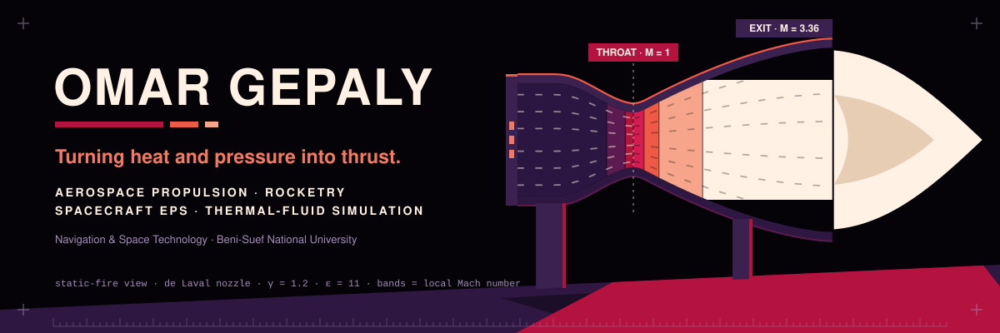

 

> **Abstract.** I'm a Navigation & Space Technology student focused on **aerospace propulsion and rocketry**, **spacecraft electrical power systems (EPS)**, and **thermal-fluid simulation**. Rockets are energy-conversion machines: chemistry makes heat, a nozzle turns heat into directed momentum, and an electrical system keeps everything alive on the way. This README works through that chain with numbers I computed myself.

Open to internships and collaborations in propulsion, rocketry, and spacecraft systems.

